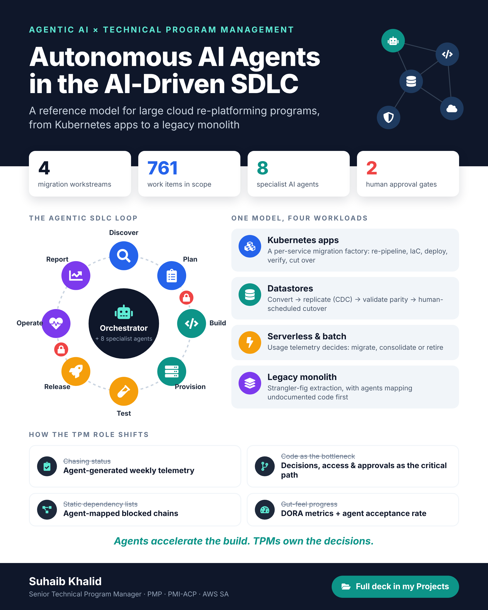
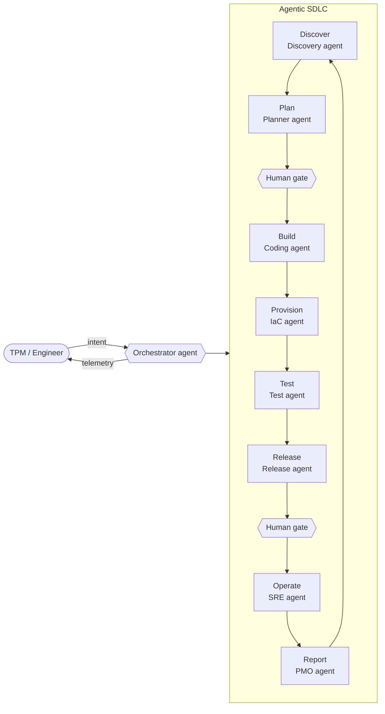

# Agentic SDLC Reference Model

**Autonomous AI Agents and Their Role in the AI-Driven Software Development Lifecycle**

This repo holds a reference model for using autonomous AI agents across the SDLC of a large enterprise cloud migration. The slide deck, LinkedIn flyer and profile banner are all generated from code.

> **Scope note:** this is a reference model and a set of documentation artifacts. It is **not** an agent implementation. It draws on my experience as a Technical Program Manager leading a multi-workstream cloud re-platforming program. All program figures are anonymized and illustrative. The production migration work is proprietary and is not included here.



## The model

An orchestrator agent assigns work to eight specialist agents, one for each SDLC phase. Humans keep two approval gates: scope sign-off before build, and production change approval before operate.



Agents reach enterprise systems only through governed tool connectors: source control, CI/CD, IaC state, work tracker, observability, secrets and chat. Guardrails include least-privilege IAM, policy-as-code (OPA), branch protection, change-request approval and a full audit trail.

## Four workload patterns

| Workload | Pattern | Where agents add leverage |
|---|---|---|
| Kubernetes applications | Per-service migration factory | Pipeline and Helm generation, Terraform drift detection, canary watch, change-request drafting |
| Datastores | Convert → replicate (CDC) → validate → cut over | Schema and query conversion, connector configs, parity checks |
| Serverless, batch & tooling | Migrate, consolidate or retire | Inventory and usage telemetry, staged decommission, IAM and schedule cleanup |
| Legacy monolith | Strangler-fig extraction | Mapping undocumented code, cross-repo SDK upgrades, config-management to IaC |

**Key lesson:** agents remove the code bottleneck. The critical path moves to decisions, access and approvals, and those stay with the TPM.

**Measuring it:** the four DORA metrics (lead time, deployment frequency, change failure rate, time to restore), plus agent acceptance rate and blocked-days on the critical path.

More detail is in [docs/model.md](docs/model.md).

## Artifacts

| Artifact | Output | Source |
|---|---|---|
| Slide deck (19 slides) | [PDF](deck/Autonomous-AI-Agents-SDLC.pdf) | [deck/build.js](deck/build.js) (pptxgenjs) |
| LinkedIn flyer (4:5) | [PNG](flyer/AI-Agents-SDLC-Flyer.png) | [flyer/build.js](flyer/build.js) (HTML/SVG → Playwright) |
| LinkedIn banner (4:1) | [PNG](banner/LinkedIn-Banner-Agentic-TPM.png) | [banner/build.js](banner/build.js) (SVG → Playwright) |

## Build

```bash
npm install
npx playwright install chromium
npm run build        # or: npm run deck | npm run flyer | npm run banner
```

`npm run deck` writes an editable `.pptx`, which opens in PowerPoint or Google Slides.

## How this was made

I designed the model and content. The build scripts were written with an AI coding assistant, an agentic workflow in practice.

## Author

**Suhaib Khalid**, Senior Technical Program Manager · PMP · PMI-ACP · AWS Solutions Architect
[LinkedIn](https://www.linkedin.com/in/suhaibq/)

Code is MIT-licensed. Deck, flyer and banner content © Suhaib Khalid.
